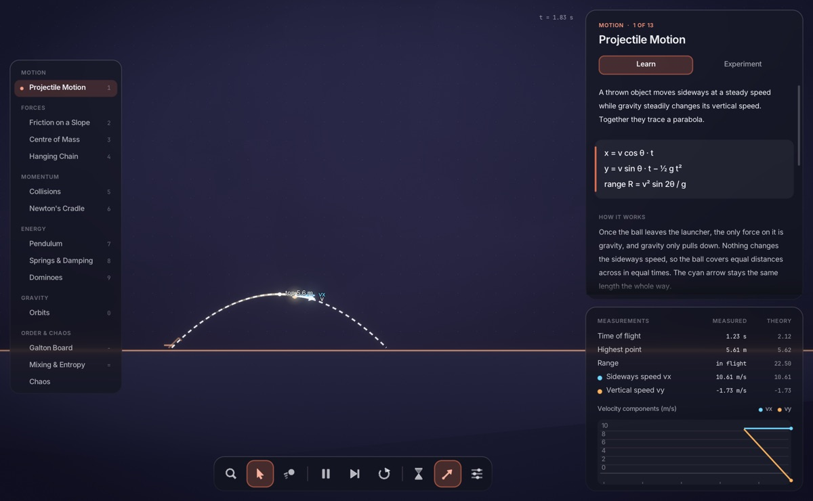
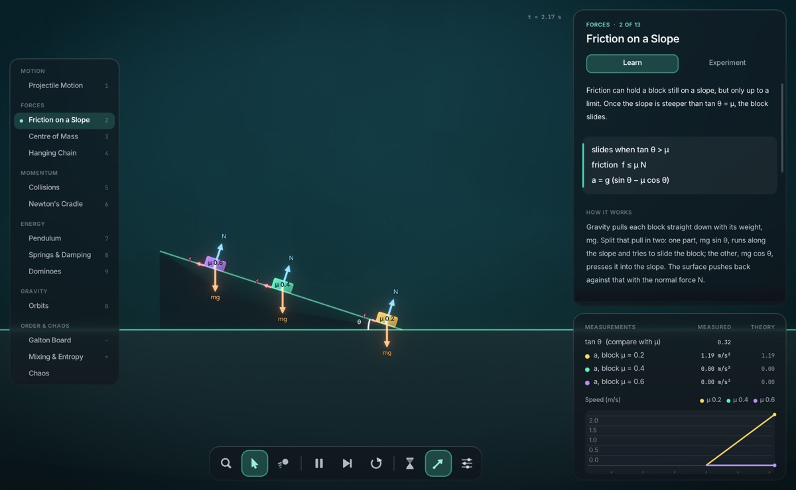
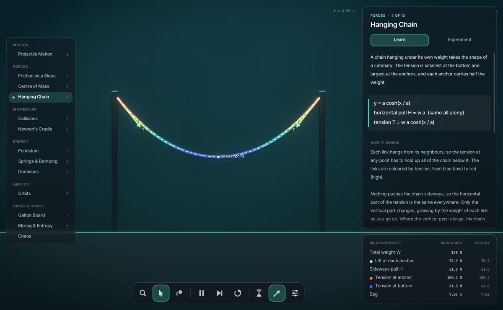
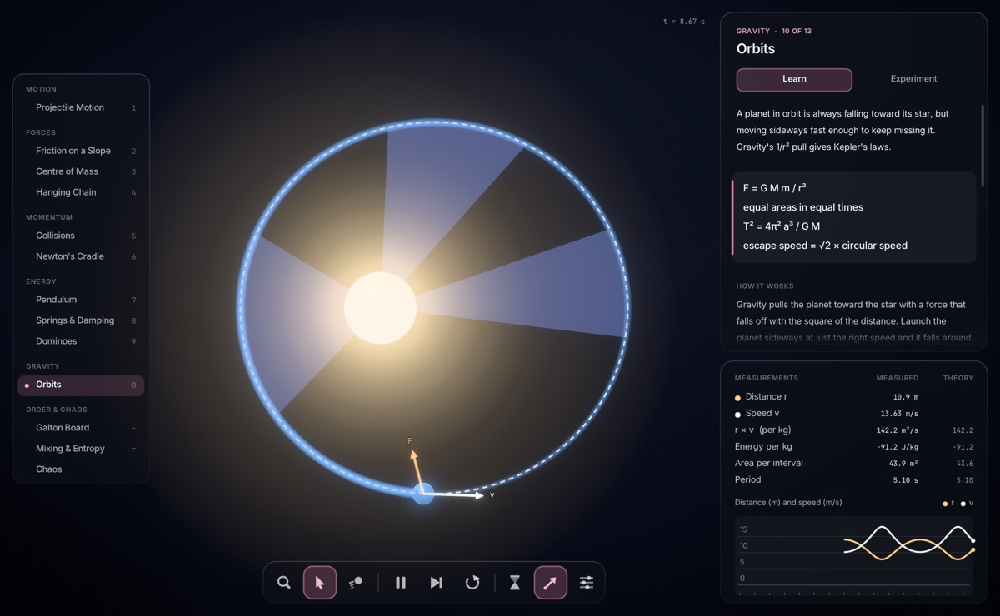
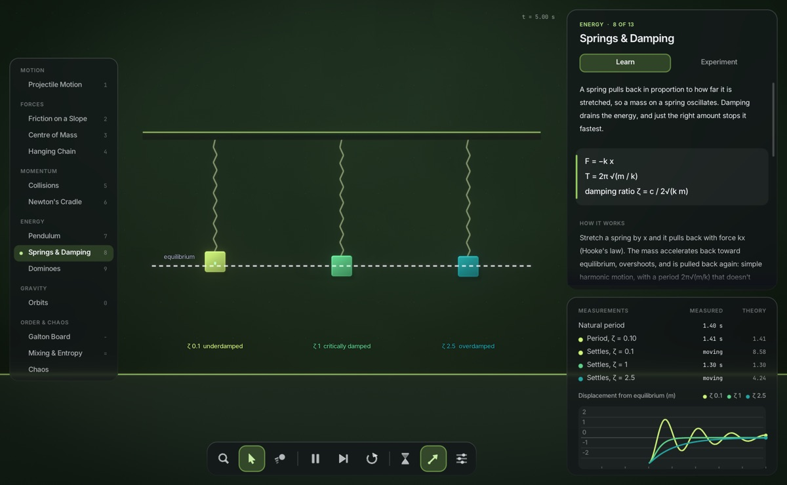

# Inertia

An interactive physics lab in C++20. Each of its thirteen lessons sets up an experiment that
shows one principle, explains it, measures what happens and puts the measurement next to what
the theory predicts. The rigid-body solver is written from scratch. It runs on the desktop
and, compiled to WebAssembly, in the browser.

**[Try it in your browser](https://michaeldjabauri.github.io/inertia/)**

This is a personal project made for fun and for learning, not a physics library. There's no
API to build on and no stability promises, and it's only been tested in Chrome on one Intel Mac.


| | | |
|---|---|---|
|  |  |  |
|  |  |  |

## The lessons

| Lesson | Principle | Measured against theory |
|---|---|---|
| Projectile Motion | Steady sideways motion plus steady fall make a parabola | Range, height and flight time |
| Friction on a Slope | A block slides once tan θ > μ | Each block's acceleration |
| Centre of Mass | Balance holds while the centre of mass is over the support | How far a stack can reach |
| Hanging Chain | A hanging chain is a catenary; each anchor holds half its weight | Anchor forces, tension and sag |
| Collisions | Momentum is always conserved; energy only if e = 1 | Momentum, energy and velocities after |
| Newton's Cradle | Conserving momentum and energy together | Balls swinging out, rebound height |
| Pendulum | Energy trades between kinetic and potential; T ≈ 2π√(L/g) | Period (exact and small-swing), energy |
| Springs & Damping | Hooke's law and the damping ratio | Period and settling times |
| Dominoes | Stored energy released in an exponential chain | Energy released against the push |
| Orbits | Kepler's laws follow from a 1/r² pull | Period, r × v, energy, area swept |
| Galton Board | The central limit theorem | Mean and spread of the pile |
| Mixing & Entropy | The second law of thermodynamics | Coarse-grained entropy over time |
| Chaos | Small differences grow exponentially | Gap between pendulums, doubling time |

Each lesson has two tabs. **Learn** gives the principle, its equations, how it works and where
it's used in the real world. **Experiment** has controls for the setup, things to try, and a
key to the arrows on screen. Below them, **Measurements** shows live readings beside the
theory's prediction, with a plot of the last few seconds.

Velocities, forces and momenta are drawn as labelled arrows. The Inspect tool reads out any
body's mass, speed, momentum and energy, and Settings changes gravity, including to the Moon's
or Jupiter's.

| Input | Action |
|---|---|
| Click or drag | Use the selected tool: inspect, grab or throw |
| Right click | Remove a body |
| Scroll | Zoom, or scroll the lesson text |
| `1`–`9`, `0`, `-`, `=`, `[` `]` | Choose a lesson |
| `Space` / `.` / `R` | Pause / step one frame / restart |
| `S` / `V` | Slow motion / show or hide the arrows |
| `Q` `W` `E` | Inspect, grab, throw |
| `Tab` | Settings: gravity, time, solver substeps |
| `H` / `F` | Hide the interface / full screen |

## How accurate is it?

The scene tests run every lesson headless and compare its measurements with its theory.
A sample:

| Check | Theory | Measured |
|---|---|---|
| Projectile range, 15 m/s at 45° | 22.50 m | 22.47 m |
| Pendulum period, 8 m released at 30° | 5.718 s | 5.718 s |
| Pendulum period released at 80° (the small-swing formula says 5.62 s) | 6.393 s | 6.393 s |
| Block sliding down a 30° slope with μ = 0.4 | 1.536 m/s² | 1.536 m/s² |
| Chain tension at the anchors | 100.2 N | 100.2 N |
| Collision of 2 kg and 6 kg pucks at e = 0.5, the 6 kg puck's speed after | 2.250 m/s | 2.250 m/s |
| Settling time of a critically damped spring | 1.304 s | 1.300 s |
| Orbit period at 85% of circular speed | 5.097 s | 5.099 s |
| Galton board spread σ | 1.94 | 1.92 |

A few lessons cheat a little, and say so. The Galton balls ignore each other until they reach
the bins, the cradle's balls have a tiny gap, and friction uses one μ for both sticking and
sliding. Mass grows with area in a 2D world, so the dominoes' energy grows as ratio³ rather
than ratio⁴. A tall stack needs a few percent of margin to stand, and the chain and the stack
use more solver substeps than the other lessons.

## How it works

1. **Time.** Physics always advances in fixed steps of 1/60 s, however fast the screen
   refreshes. Drawing blends between the last two steps, so motion stays smooth.
2. **Collisions.** Sorting bounding boxes along one axis rules out most pairs cheaply.
   The separating axis theorem then finds the exact contacts for the rest. Contacts form
   slightly before bodies touch, which stops fast objects passing through walls.
3. **Solving.** This follows the soft step approach from Box2D v3. Each step is split into
   small substeps, and contacts and joints act as very stiff, damped springs. That stays
   stable where perfectly rigid constraints would overshoot.
4. **Measuring.** After every step, each lesson reads the world: positions, velocities, and
   the impulses the solver applied at contacts and joints, which give the forces. Lessons
   depend only on the physics core, so the same measurements run in the tests.
5. **Sleeping.** Groups of touching bodies that have settled stop simulating until something
   hits them.
6. **Rendering.** Scenes draw into a 16-bit float target, so bright things can exceed white.
   Bloom and tone mapping turn that into the final image.
7. **The browser.** Emscripten compiles the same C++ to WebAssembly, and raylib draws through
   WebGL 2 instead of OpenGL. The whole site is about 2 MB.

## Build and run

You need CMake 3.20+ and a C++20 compiler. CMake downloads raylib for you.

```sh
cmake -S . -B build
cmake --build build
./build/inertia
```

To build for the browser, install [Emscripten](https://emscripten.org/) and run:

```sh
emcmake cmake -S . -B build-web
cmake --build build-web
python3 -m http.server --directory build-web/site 8000
```

Then open <http://localhost:8000>. Pushes to `main` publish the site through
[GitHub Actions](.github/workflows/pages.yml).

## Tests

```sh
ctest --test-dir build       # physics, and every lesson against its theory
tests/interaction_tests.sh   # drives the real app, and needs an awake display
```

## Credits

The solver follows Erin Catto's work on Box2D v3, and the bloom follows Jorge Jimenez's
Call of Duty: Advanced Warfare talk. Built with [raylib](https://www.raylib.com/). Fonts are
Inter and JetBrains Mono, both under the SIL Open Font License.
