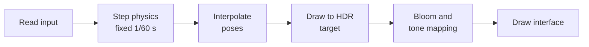

# Inertia

A 2D physics sandbox written in C++20, with the solver built from scratch. It runs on
the desktop and, compiled to WebAssembly, in the browser.

**[Try it in your browser](https://michaeldjabauri.github.io/inertia/)**


| | | |
|---|---|---|
|  |  |  |
|  |  |  |

## Scenes

| Scene | What it shows |
|---|---|
| Playground | A loose pile of circles, boxes and gems to throw things at |
| Pyramid | 136 stacked boxes standing still, until a cannonball arrives |
| Dominoes | Each domino is 10% bigger, so a small push grows into a slam |
| Newton's Cradle | Momentum passes through the middle balls and they barely move |
| Wrecking Ball | A heavy ball on a light chain against a wall of bricks |
| Suspension Bridge | Thirty pinned planks sagging under falling weights |
| Galton Board | Random bounces that pile up into the predicted bell curve |
| Tumbling Drum | A rotating drum mixing 579 balls in bands of colour |
| Binary Stars | Two suns, planets and an asteroid belt under real inverse-square gravity |
| Chaos | Twenty double pendulums started 0.001 radians apart |
| Jelly | Soft bodies made from rings of particles and springs |
| Rover | A sprung buggy on endless hills that drives itself until you take over |

## Controls

| Input | Action |
|---|---|
| Left drag on a body | Grab it (with the Grab tool) |
| Left click / drag | Drop / throw a body (with the Ball, Box or Gem tool) |
| Left click | Explode (with the Blast tool) |
| Hold left | Pull bodies towards the cursor (with the Pull tool) |
| Right click on a body | Remove it |
| Right or middle drag, or left drag on empty space | Pan |
| Scroll | Zoom |
| `1`–`9`, `0`, `-`, `=` | Choose a scene |
| `[` `]` | Previous / next scene |
| `Space` / `.` | Pause / step one frame |
| `R` | Restart the scene |
| `Tab` | Settings: gravity, time, bounce, substeps |
| `T` `B` `V` `C` | Trails, bloom, colour by speed, show contacts |
| `H` | Hide the interface |
| `F` | Borderless window, or full screen in a browser |
| `←` `→` or `A` `D` | Drive (Rover scene) |

## How it works

Every frame does the same few things:



### Time

Physics always advances in steps of exactly 1/60 of a second, however fast the screen
refreshes. Each frame adds the time that has passed to a running total and takes as many
whole steps as fit. Fixed steps keep the simulation stable and repeatable, since a
variable step would change the behaviour of every spring and stack.

Whatever time is left over gets used when drawing, by blending each body between its last
two positions. Motion looks smooth at any refresh rate, and the physics never notices. If
a machine can't keep up, the simulation slows down instead of spiralling.

### Finding collisions

Testing every pair of bodies gets slow fast: 500 bodies make about 125,000 pairs. So the
work happens in two passes.

The **broad phase** rules out most pairs cheaply. It projects each body's bounding box onto
one axis, sorts them, and only considers boxes whose ranges overlap. This is called sort
and sweep. It uses whichever axis the bodies are most spread out along, because that's
where sorting separates them best.

The **narrow phase** works out the exact contact for the pairs that remain, using the
separating axis theorem: if you can find any direction along which two convex shapes don't
overlap, they aren't touching. Otherwise, the direction with the smallest overlap gives the
contact normal, and clipping the two nearest edges against each other gives one or two
contact points. Each point keeps an ID, so the same contact can be recognised on the
next step.

Contacts also form a little *before* bodies touch, with a margin that grows with speed.
A fast body gets stopped by a contact it hasn't reached yet, which is why a 150 m/s ball
can't pass through a 10 cm wall.

### Solving

The solver turns contacts and joints into velocity changes that stop bodies overlapping,
and it follows the "soft step" approach used by Box2D v3. Rather than running many
iterations on one big step, each 1/60 s step is cut into small substeps, six by default:

1. **Integrate velocities.** Apply gravity and other forces.
2. **Warm start.** Reapply last step's impulses, since contacts rarely change much. This
   is what lets a tall stack stand still.
3. **Solve.** Apply impulses, with a gentle push to correct any overlap.
4. **Integrate positions.** Move the bodies.
5. **Relax.** Solve again without the push, so correcting an overlap doesn't add energy
   and launch things.

Contacts and joints behave as very stiff, damped springs instead of perfectly rigid rods.
That sounds worse, but it's far more stable: a spring has a defined response however bad
the overlap gets, while a rigid constraint can overshoot and explode.

Bounce is applied once after the substeps, using the speeds from before the collision.

### Joints

Revolute joints pin two bodies at a point, with an optional motor and angle limits.
Distance joints work as rigid rods, ropes or springs. Grabbing a body with the mouse is
also a joint. Joint solving alternates direction on each pass, which carries load along
chains in both directions and lets a light chain hold a heavy wrecking ball.

The Jelly scene needs no special soft body code. Each blob is a ring of small particles
held together by springs.

### Sleeping

Bodies that touch are grouped into islands using union-find. Once everything in an island
has stayed still for a moment, the whole island stops simulating, and a nearby impact wakes
it up. Grouping matters here: a stack that slept one box at a time could fall asleep halfway
through collapsing.

### Rendering

Scenes draw into a 16-bit floating point target, so a glowing body can be many times
brighter than white without clipping. Three passes turn that into the final image:

- **Bloom.** The image is repeatedly shrunk and then blurred back up, which gives bright
  areas a wide, soft halo. It uses Jimenez's 13-tap downsample, which avoids the shimmer of
  a plain blur.
- **Tone mapping.** Khronos PBR Neutral squeezes the bright range down to what a screen can
  show, while leaving ordinary colours true to the palette.
- **Dither.** A trace of noise stops dark gradients from banding.

Float targets have no hardware antialiasing, so every shape is drawn with a one-pixel
feathered edge instead. The same primitive produces shadows, rims and glows. Light comes
from a fixed direction, so shading stays put as bodies rotate. The frosted interface panels
sample the blurred scene from the bloom chain, so they cost almost nothing to draw.

If frames run long, the scene resolution drops automatically while the interface stays sharp.

### In the browser

[Emscripten](https://emscripten.org/) compiles the same C++ to WebAssembly, so the physics,
scenes and interface are identical to the desktop build. [raylib](https://www.raylib.com/)
draws through WebGL 2 instead of OpenGL. A few things had to change:

- **The frame loop.** A browser can't run a `while` loop forever, so it calls `frame()` once
  per display refresh instead.
- **Shaders.** WebGL uses GLSL ES, which is stricter than desktop GLSL. The shaders are written
  for the stricter rules, and the version line is swapped at compile time.
- **Sharpness.** The page sets the canvas size, and the app matches it in device pixels so
  Retina screens stay crisp. Small screens shrink the interface to fit.

The whole site, fonts included, is about 2 MB.

## How accurate is it?

The tests compare the simulation against known answers, and these are the measured results:

| Check | Theory | Measured |
|---|---|---|
| Newton's Cradle: height the far ball reaches | 100% | 99.9% |
| Galton Board: spread of the pile | 1.94 | 1.92 |
| Pendulum: energy error over 20 s | 0 | 0.12% |
| 136-box pyramid: worst drift after 10 s | 0 | 2 cm |
| Chain with a 150:1 mass ratio: peak stretch | 0 | 7% |
| Binary Stars: bodies flung out in 60 s | 0 of 186 | 0 of 186 |

Chaos is the fun one, because the pendulums are supposed to disagree. They start 0.001 radians
apart, are spread over 0.25 m after 3 s, and over 10.83 m after 25 s.

## Build and run

You need CMake 3.20+ and a C++20 compiler. CMake downloads raylib into the build folder, so
nothing gets installed on your system.

```sh
cmake -S . -B build
cmake --build build
./build/inertia
```

### For the browser

With [Emscripten](https://emscripten.org/docs/getting_started/downloads.html) installed:

```sh
emcmake cmake -S . -B build-web
cmake --build build-web
python3 -m http.server --directory build-web/site 8000
```

Then open <http://localhost:8000>. Browsers won't load WebAssembly from a `file://` address, so
opening `index.html` directly doesn't work. Add `?scene=8` to the address to start on a
particular scene, counting from 0.

### GitHub Pages

[`.github/workflows/pages.yml`](.github/workflows/pages.yml) builds the site, runs the engine
tests, and publishes on every push to `main`. To use it on a fork, set **Settings → Pages →
Source** to **GitHub Actions**.

## Tests

```sh
ctest --test-dir build              # physics and scene behaviour, no window needed
tests/interaction_tests.sh          # drives the real app with scripted input
```

The interaction tests open a window briefly, so they need an awake display of at least
1000×640. The headless tests also run as WebAssembly, which is how the workflow checks the
engine before publishing:

```sh
node build-web/physics_tests.js
node build-web/scene_tests.js
```

## Project layout

```text
src/physics/   the engine: collision, joints and the solver, with no graphics dependency
src/scenes/    the twelve scenes, which only depend on the physics
src/render/    HDR pipeline, shaders and everything that draws bodies
src/ui/        immediate mode interface
src/app.cpp    the frame loop, input and the HUD
web/           the page that hosts the browser build
tests/         physics, scene and interaction tests
```

## Known limits

- Developed on an Intel Mac and tested in Chrome. Other systems and browsers should work, but
  they're untested. Phone layouts have only been tested in Chrome's device emulation.
- The browser build needs WebGL 2.
- Bodies have a single shape, so concave objects need several bodies and joints.
- A contact chain can't pass bounce along within one step. Newton's Cradle works because its
  balls have a tiny gap, which gives each collision its own step.
- The Galton Board's balls ignore each other until they reach the bins, because the theory
  assumes independent balls.
- The Rover has a gyro that helps it stay upright, which isn't realistic.
- macOS has deprecated OpenGL. It still works, but a Metal backend would be the long-term fix.
- If the desktop app exits saying it could not open a window, the display was probably asleep.
  Launch it again.

## Credits

The solver follows the soft step approach from Erin Catto's work on Box2D v3. Bloom follows
Jorge Jimenez's "Next Generation Post Processing in Call of Duty: Advanced Warfare". Tone
mapping uses Khronos PBR Neutral. Windowing and input come from [raylib](https://www.raylib.com/).

Fonts are in `assets/fonts` with their licences: Inter and JetBrains Mono, both under the SIL
Open Font License.
