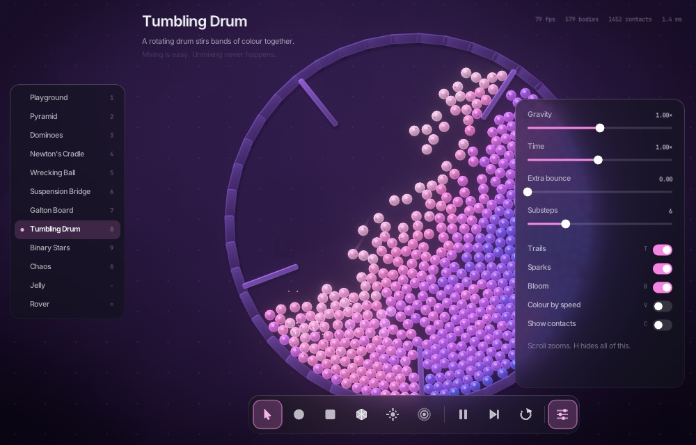
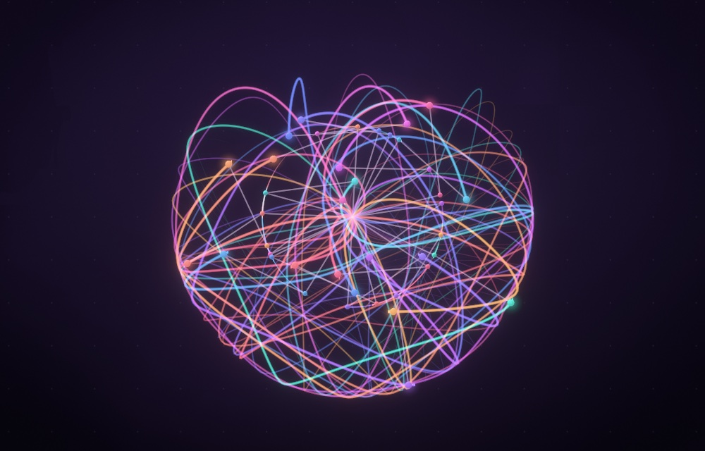
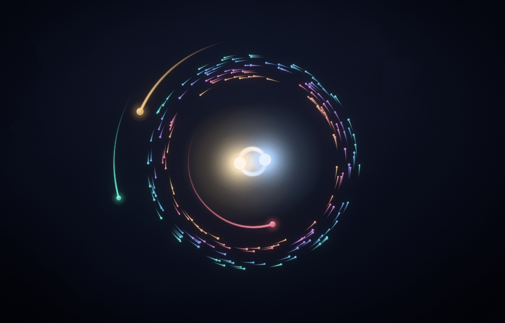
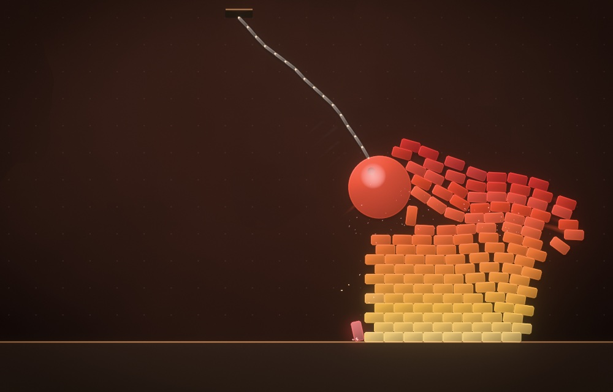
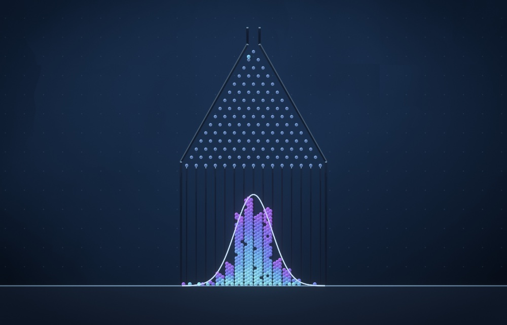
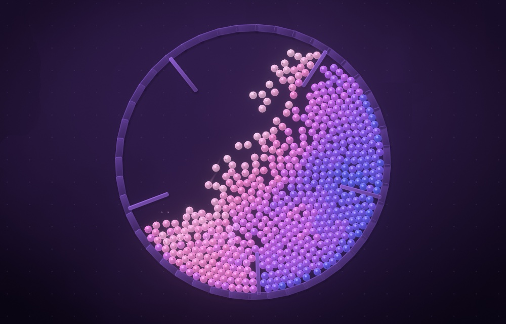
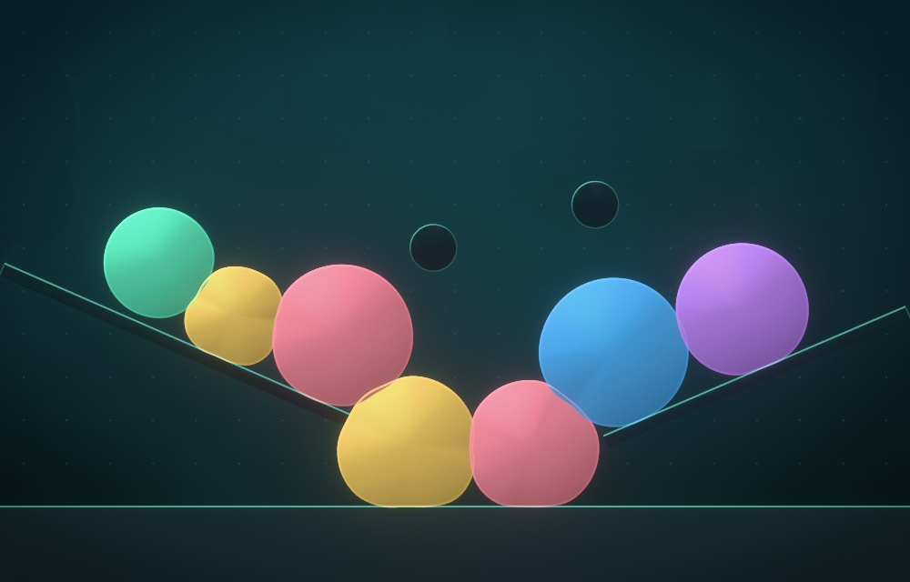

# Inertia

A 2D rigid-body physics sandbox in C++20. The solver is written from scratch and
the only dependency is [raylib](https://www.raylib.com/), which handles the window
and OpenGL. CMake fetches it into the build folder, so nothing is installed on your
system.



| | | |
|---|---|---|
|  |  |  |
|  |  |  |

## Build and run

You need CMake 3.20+ and a C++20 compiler. The first build needs internet access to
download raylib.

```sh
cmake -S . -B build
cmake --build build
./build/inertia
```

## Controls

| Input | Action |
|---|---|
| Left drag on a body | Grab it (with the Grab tool) |
| Left click / drag | Drop / throw a body (with the Ball, Box or Gem tool) |
| Left click | Explode (with the Blast tool) |
| Hold left | Pull bodies towards the cursor (with the Pull tool) |
| Right click on a body | Remove it |
| Right or middle drag, or left drag on empty space | Pan |
| Scroll | Zoom |
| `1`–`9`, `0`, `-`, `=` | Choose a scene |
| `[` `]` | Previous / next scene |
| `Space` / `.` | Pause / step one frame |
| `R` | Restart the scene |
| `Tab` | Settings: gravity, time, bounce, substeps |
| `T` `B` `V` `C` | Trails, bloom, colour by speed, show contacts |
| `H` | Hide the interface |
| `F` | Borderless window |
| `←` `→` or `A` `D` | Drive (Rover scene) |

## Scenes

| Scene | What it shows |
|---|---|
| Playground | A loose pile of circles, boxes and gems to throw things at |
| Pyramid | 136 stacked boxes standing still, until a cannonball arrives |
| Dominoes | Each domino is 10% bigger, so a small push grows into a slam |
| Newton's Cradle | Momentum passes through the middle balls and they barely move |
| Wrecking Ball | A heavy ball on a light chain against a wall of bricks |
| Suspension Bridge | Thirty pinned planks sagging under falling weights |
| Galton Board | Random bounces that pile up into the predicted bell curve |
| Tumbling Drum | A rotating drum mixing 579 balls in bands of colour |
| Binary Stars | Two suns, planets and an asteroid belt under real inverse-square gravity |
| Chaos | Twenty double pendulums started 0.001 radians apart |
| Jelly | Soft bodies made from rings of particles and springs |
| Rover | A sprung buggy on endless hills that drives itself until you take over |

## How it works

**Physics** (`src/physics/`) has no graphics dependency. Each 1/60 s step runs:

1. **Broad phase.** Sort-and-sweep along whichever axis the bodies are most spread out on.
2. **Narrow phase.** Separating-axis tests with edge clipping give contact manifolds.
   Contacts form before bodies touch, which is what stops fast bodies tunnelling.
3. **Substeps.** Integrate, warm start, solve with bias, move, then relax without bias.
   This is the soft-constraint "small steps" approach used by Box2D v3. Contacts and
   joints behave as stiff damped springs.
4. **Restitution.** Bounce is applied once, after the substeps.
5. **Sleeping.** Groups of touching bodies that have settled stop simulating.

**Rendering** (`src/render/`) draws into a 16-bit float target, builds bloom from a
downsample and upsample chain, then tone maps. Render textures have no MSAA, so every
shape carries a one-pixel feathered edge. The same band primitive produces shadows,
rims and glows. Light comes from a fixed direction, so shading stays put as bodies turn.

Rendering falls between physics steps by interpolating poses, so motion stays smooth at
any refresh rate. If frames run long, the scene resolution drops automatically.

## Tests

```sh
ctest --test-dir build              # headless: physics and scene behaviour
tests/interaction_tests.sh          # drives the real app with scripted input
```

The headless tests check behaviour against known answers rather than just running the
code. For example, a chain must not stretch more than 8% at a 150:1 mass ratio, the far
ball of the cradle must rise to at least 93% of the release height, and the Galton pile
must land within 0.3 of the binomial spread.

The interaction tests open a window briefly, so they need a display of at least 1000×640.

## Known limits

- Developed and tested on an Intel Mac only. raylib is cross-platform, but other systems are untested.
- Bodies have a single shape, so concave objects need several bodies and joints.
- A contact chain can't pass restitution along within one step. Newton's Cradle works
  because its balls have a small gap, which gives each collision its own step.
- Macs have deprecated OpenGL. It still works, but a Metal backend would be the long-term fix.
- If the app exits saying it could not open a window, the display was probably asleep or
  reconfiguring. Launch it again.

## Licences

Fonts are in `assets/fonts` with their licences: Inter and JetBrains Mono, both under the
SIL Open Font License.
